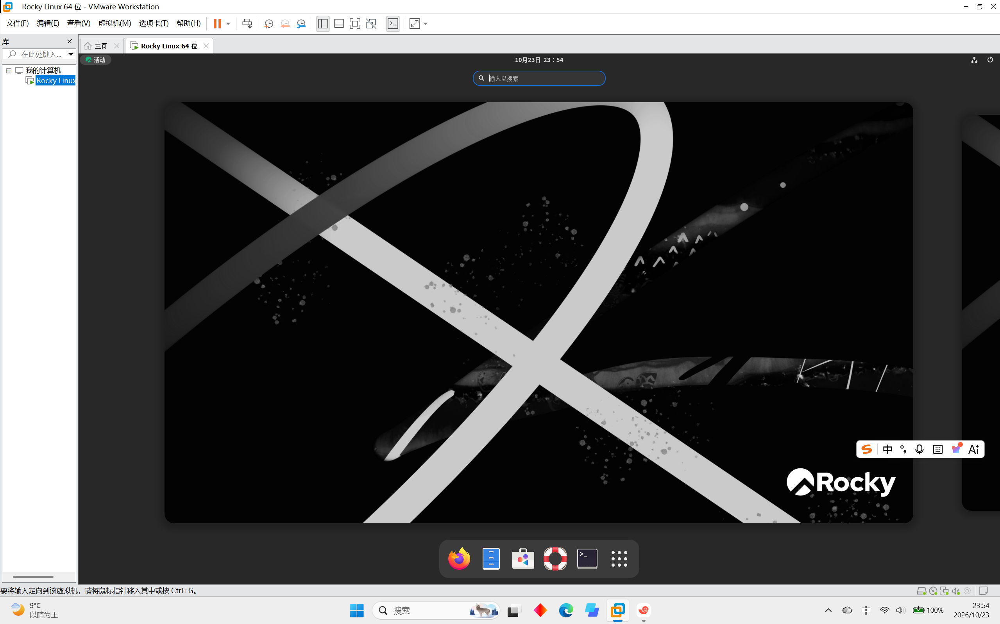
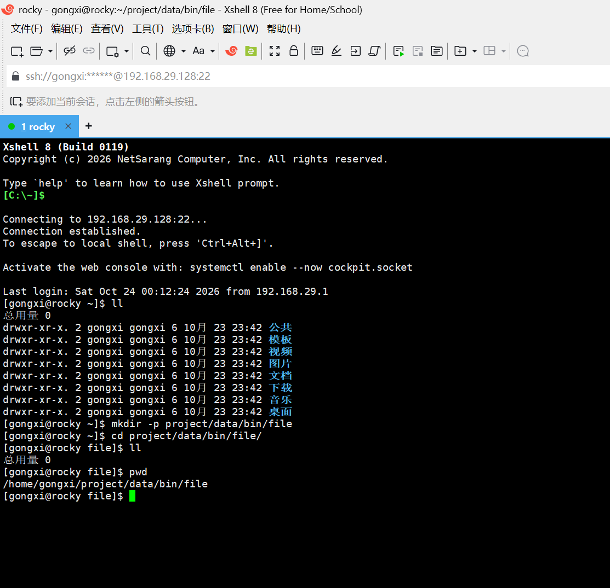
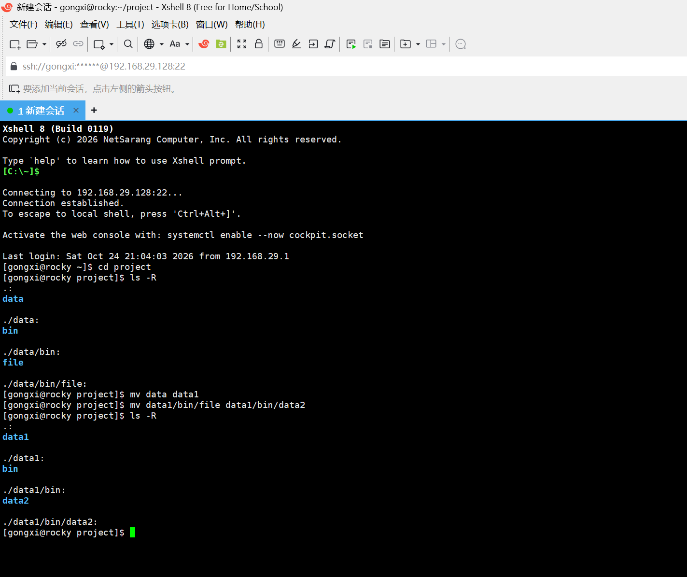
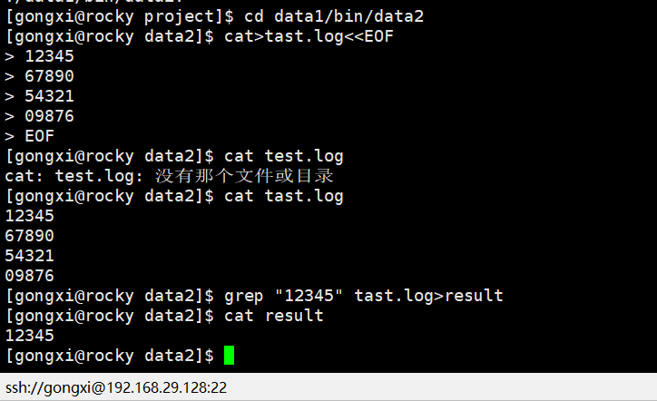

# AI-Lab 通识学习计划与环境踩坑记录

## 一、学习计划

按文档中的 Task 清单，1个月内完成所有任务。

### 目标

- 完成 Task 清单中的所有任务

### Task 清单（共 9 个）

#### Task 1：现代 AI 编程环境（Trae / VSCode）与 CLI 协同工具配置
- 安装 Trae / VSCode及CLI工具Opencode
- 完成标准：
  1.成功用Trae编写了一个简单的Python程序"hello"

  ```python
  print("hello ")
  ```
  2.成功用Opencode编写了从1到100累加整数和的Python程序
  ```python
  total = 0
  for i in range(1, 101):
    total += i
  print(total)
  ```
  还进行了一次交互，修改了代码，让用户自定义累加范围
  ```python
  n== int(input("请输入一个正整数："))
  total = 0
  for i in range(1, n+1):
    total += i
  print(total)
  ```

#### Task 2：Linux 终端基础与常用命令行实战
- 在VMware Workstation中安装Linux系统（Rocky Linux）
1. 熟练掌握目录与文件操作命令：pwd、cd、ls (或 eza)、mkdir、rm、cp、mv、cat、head、tail、find；
2. 熟练掌握文本过滤与管道操作：grep、wc、标准输入输出重定向（>、>>、|）；
3. 熟悉系统状态与进程排查：ps aux、top (或 btop)、kill、df -h、free -m；
4. 掌握文件权限基础：chmod、chown。
- 完成标准：









- 踩坑记录：[见「坑 1」](#坑-1关联-task-2)

#### Task 3：Git 版本管理规范与 GitHub 协作实操

- 设置VS Code为Git默认编辑器
- 复习 Python 语法，练习 numpy / pandas 的数组与表格操作，matplotlib 画图
- 完成标准：独立完成一个数据读取 → 清洗 → 可视化的小练习

#### Task 4：Conda 虚拟环境隔离与镜像源加速配置

- [ ] 状态：未开始
- 理解监督/无监督学习、训练集/测试集、过拟合、常见指标（准确率、MSE 等）
- 完成标准：用 scikit-learn 跑通一个分类小例子（如鸢尾花）

#### Task 5：Docker 容器化技术初探

- [ ] 状态：未开始
- 理解神经元、反向传播、激活函数、损失函数、优化器（SGD/Adam）
- 完成标准：用 PyTorch 手写一个两层网络完成 MNIST 手写数字分类

#### Task 6：Python 核心语法与常用数据结构

- [ ] 状态：未开始
- 了解卷积、池化、经典网络（LeNet/ResNet 概念），学会用迁移学习
- 完成标准：基于预训练模型完成一次图像分类微调

#### Task 7：Python 文件 I/O、异常处理与工程基础

- [ ] 状态：未开始
- 了解词向量、Transformer、Attention 机制，了解 LLM 的基本使用方式（API / 本地部署）
- 完成标准：调用一次 LLM API 或本地跑通一个小模型问答

#### Task 8：经典算法与编程逻辑专项巩固

- [ ] 状态：未开始
- 选一个方向（图像 / 文本 / 表格数据）完成端到端小项目：数据 → 训练 → 评估 → 简单部署（Gradio/Streamlit）
- 完成标准：项目代码入库，附 README

#### Task 9：通识综合微项目实战

- [ ] 状态：未开始
- 整理学习笔记，汇总所有踩坑记录，输出一份学习总结
- 完成标准：本文件「踩坑记录」填写完整，总结笔记归档

## 二、环境踩坑记录

### 坑 1（关联 Task 2）

#### 现象

B 站主流教学视频均采用 CentOS 7 演示，但该系统已停止维护，照教程操作无法获得可用、稳定的环境。

#### 原因

CentOS 7 已停止维护（EOL），原有镜像源逐步下线，教程中的安装与配源步骤已过期，直接照做会卡在镜像源不可用这一步。

#### 解决方法

与 AI 智能体反复交互，确认可用 Rocky Linux 替代 CentOS（同为 RHEL 系、命令基本一致）；再通过小红书等社区帖子找到可用的镜像网站，从而快速完成系统下载与配置。
