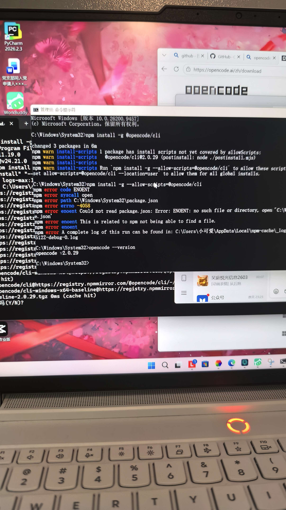
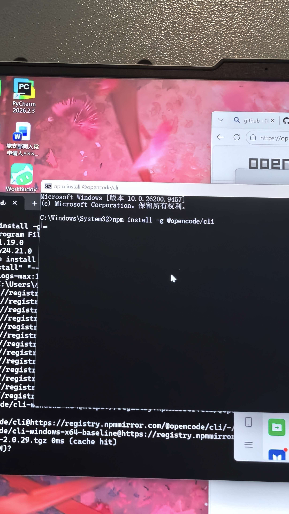

# AI-Lab 通识学习计划与环境踩坑记录

## 一、 个人技术笔记目录体系
为了系统地记录本次 AI-Lab 的学习过程，我建立了以下笔记目录体系：
*   `01_环境配置`：记录 Node.js、OpenCode、VS Code 的安装与配置过程。
*   `02_排错记录`：记录在终端遇到的权限报错、网络卡顿等问题的解决方案。
*   `03_技术摘记`：记录 Markdown 语法笔记和优秀开源项目链接。

## 二、 通识学习计划

| 时间 | 任务 |
| :--- | :--- |
| 10.20-10.27 | Task03-06 |
| 10.28-11.9 | Task07-09 |
| 11.10-11.14 | Task10 |

## 三、 环境踩坑记录与代码实验

```bash
- 1. 解决 npm 下载卡死的问题（切换为国内淘宝镜像源）
npm config set registry https://registry.npmmirror.com

- 2. 解决 PowerShell 提示“禁止运行脚本”的权限问题
Set-ExecutionPolicy RemoteSigned -Scope CurrentUser
```
## 四、截图





